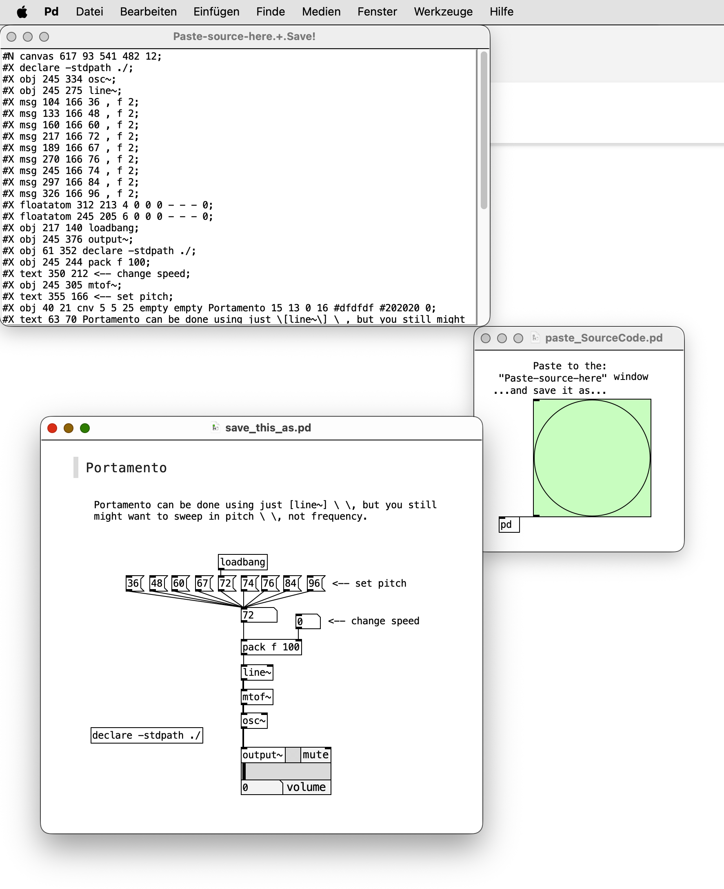

# Pure Data 

What you find here: Paste_SourceCode and Pd -> PS finally PDF batch conversion

The folder "doc" has PDF print-outs of Pure-Data° Help-Patches from the Pure-Data documentation°°°.
The folder "ps" contains all postscript print-outs saved with the help of canvas.top from the ceammc°° library.

"paste the subpatch to print as ps.pd" I used to create postscript files.

It is tested with pd-0.56.2 and the ceammc library from deken. You can install "ceammc" by "Find Externals online" from the repository. 

Why:

During research it is sometime good link patches to a database.
But databases results are mostly text.
Pd -> PS -> PDF 
To use pd-source code and to have later visual references handy I use the "paste the subpatch to print as ps.pd" patch.
To easy paste database results inside Pure-Data i have here the "paste_SourceCode.pd" patch.

The "paste_SourceCode.pd" patch is there for to insert .pd source-code inside pure-data.

° Pd the free real-time computer music system. https://puredata.info
°° There is also the https://github.com/uliss/pd-ceammc/releases distribution forked from pure-data.
°°° Pure-Data documentation https://github.com/pure-data/pure-data/tree/master/doc

This file https://github.com/einkilometer/pure-data/tree/main
View site https://einkilometer.github.io/pure-data/

