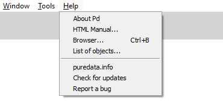
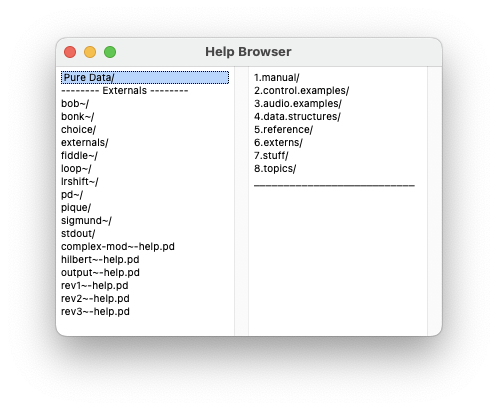
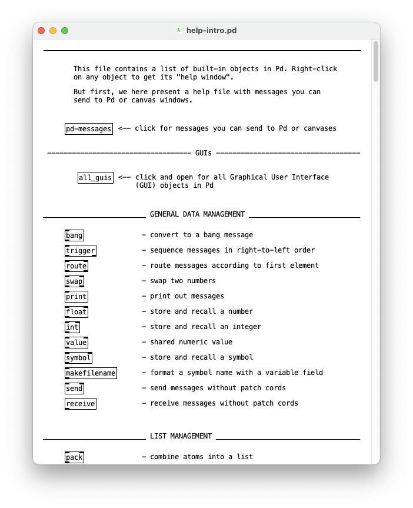

[Table of contents](index.htm#s1)

[Chapter 2: Theory of operation \>](2.theory.of.operation.htm)

## Chapter 1: Introduction

This is the official HTML manual for Pure Data, a patchable computer music environment for audio analysis, synthesis and digital signal processing in real time (aka "Live Electronics"). Pd can be extended with third-party libraries for additional computer music features, multimedia capabilities and more, making Pd a programming environment also for video, graphics, interfacing with arduino, etc.

Pd is commonly used for live music performance, VeeJaying, sound effects, composition, audio analysis, interfacing with sensors, using cameras, controlling robots, designing apps, procedural audio for games or even interacting with websites. Because all of these various media are handled as digital data within the program, many fascinating opportunities for cross-synthesis between them exist. Sound can be used to manipulate video, which could then be streamed over the internet to another computer which might analyze that video and use it to control a motor-driven installation and whatnot.

The latest version of this manual is found online at <http://msp.ucsd.edu/software.html>, along with the downloads of the latest Pd releases.

### <a href="#s1.1" id="s1.1">1.1. Guide to Pd's documentation</a>

Besides this HTML manual, you'll find the 'doc' folder with more documentation resources in Pd's installation folder, which is also accessible through the **Help menu**. Here's an overview of its structure:

\
Pd/\
├── doc/\
    ├── 1.manual/\
    ├── 2.control.examples/\
    ├── 3.audio.examples/\
    ├── 4.data.structures/\
    ├── 5.reference/\
    ├── 6.externs/\
    ├── 7.stuff/\
    ├── 8.topics/\

- The first subfolder **1.manual** includes this HTML manual and consists of 6 sections:
  - This [introduction](1.introduction.htm)
  - A [theory of operations](2.theory.of.operation.htm), explaining how Pd works
  - Instructions on [installing and configuring Pd](3.installing.configuring.htm)
  - Information on managing [externals](4.externals.htm)
  - The [changelog](5.current.status.htm)
  - Instructions on [building Pd from source](6.building.from.source.htm)
- Next, there's a series of tutorial patches, starting with **2.control.examples**, which serve as an introduction to Pd's "control" structure (as opposed to audio functions which are covered next).
- **3.audio.examples** includes a set of examples that are also part of Miller Puckette's book "The Theory and Technique of Electronic Music". The book is freely available online at <http://msp.ucsd.edu/techniques.htm>.
- **4.data.structures** is the last tutorial, giving an introduction to Pd's Data Structures feature, also described in this manual in section [2.10 Data Structures](2.theory.of.operation.htm#s2.10).
- In the **5.reference** folder, you find the help patches for all objects.
- The **6.externs** folder includes instructions on how to write externals, including sample C code for different use cases. More information on externals is found in [Chapter 4: Externals](4.externals.htm) of this manual.
- In the **7.stuff** folder, you'll find additional patches to explore.
- The last subfolder **8.topics** includes extra documentation with more details on specific topics that is referred in the help files.

### <a href="#s1.2" id="s1.2">1.2. The Help menu</a>

This section describes Pd's **Help menu**, which offers shortcuts to the documentation and other resources. "HTML Manual..." (or "Pd Help" on macOS) opens this HTML manual.

<figure>

<figcaption><u>Fig. 1.2.1</u> The Help menu</figcaption>
</figure>

The "Browser..." entry opens Pd's internal file document browser. The "Pure Data" folder shown on top of this file browser points to the 'doc' folder (just explained above) and it's a quick way to navigate and open the manual, particular help files, examples from the tutorials, etc.

<figure>

<figcaption><u>Fig. 1.2.2</u> The Help browser accessing the Pd's documentation folder</figcaption>
</figure>

In this browser window, you'll also find the 'externals' installed on your system. By default, Pd comes with an 'extra' library, so you'll find these externals here even if you have not yet installed anything.

The "List of objects" entry of the **Help menu** opens a patch that includes a list of all native objects with brief explanations.

<figure>

<figcaption><u>Fig. 1.2.3</u> The help-intro patch with a list of all internal objects</figcaption>
</figure>

The "puredata.info" entry opens [pure-data.info](http://www.pure-data.info/), an extensive Pd community website that aims to be the central resource for Pd, from downloads to forums, member pages, extra documentation resources and a patch exchange.

The "Check for updates" entry opens a [webpage with recent Pd releases](https://pdlatest.puredata.info/), so you can check if there is a new Pd version for download

The "Report a bug" entry opens the [Pd issue tracker](https://bugs.puredata.info/), where you can find known bugs and also report new ones.

### <a href="#s1.3" id="s1.3">1.3. Other resources</a>

The Pd source code is found on github, on the [Pd GitHub project page](https://github.com/pure-data/pure-data/). This project also includes a repository that focuses on Pd's documentation, called [pddp (Pure Data Documentation Project)](https://github.com/pure-data/pddp). This repository also has an [issue tracker](https://github.com/pure-data/pddp/issues) for issues related to the documentation.

Most of the interesting news related to Pd show up on the Pd mailing list, maintained by IOhannes zmölnig. To subscribe or browse the archives, visit: <https://lists.puredata.info/listinfo/pd-list>. This is the best source of recent information regarding installation problems and bugs. It is perfectly reasonable to post "beginner" questions on this list; alternatively you can contact msp@ucsd.edu for help. Many extensions for Pd also get announced on the mailing list.

Other community resources online include the [Pd forum](http://forum.pdpatchrepo.info/), a [Pd telegram group](https://telegram.me/puredata%20), a [Facebook group](https://www.facebook.com/groups/4729684494%20) and a [Discord channel](https://discord.gg/bcPZcKQkmW). Here, you can find many users that can help you with basic instructions and troubleshooting as well as other interactions with the community.

### <a href="#s1.4" id="s1.4">1.4. Other flavors</a>

Pure Data, being an open source project, can be forked into alternative projects that are developed independently. These forks are also known as "different flavors" of Pd. This manual covers the official Pure Data distribution by Miller Puckette, which is also known as the "Vanilla" flavor of Pd, so it's commonly referred to "Pd Vanilla".

Other Pd flavors mainly focus on two things, modifying the GUI to offer more user-friendliness and extending its default features with pre-installed externals. Notably, the PlugData fork also allows you to run Pd as a plugin in any DAW.

A very important and historical flavor of Pd was Pd-extended, which has been discontinued in 2014. This used to come with a vast collection of externals. Many Pure Data tutorials out there are based on this distribution. You can still follow Pd-extended tutorials if you install the necessary libraries, but note that these tutorials are very outdated and don't include many goodies that have been included in Pd Vanilla over the last years, like the **\[clone\]** object, **\[savestate\]**, **\[file\]**, multichannel connections and many more.

The currently active and main flavors of Pd are presented on the front page of <https://puredata.info/>. Note that some forks may introduce incompatibilities and not be fully up to date with Pd Vanilla. For forks that are fully compatible, the information in this manual should also apply for the most part.

[Table of contents](index.htm#s1)

[Chapter 2: Theory of operation \>](2.theory.of.operation.htm)

