

[\< Chapter 3: Installing and configuring Pd](3.installing.configuring.htm)

[Table of contents](index.htm#s4)

[Chapter 5: Current status \>](5.current.status.htm)

## Chapter 4: Externals

This chapter explains what are external objects and libraries. It also describes everything on how to install and load them in Pure Data.

Pure Data, by intent and design, has a lightweight and portable nature. Most likely you'll need or want to install externals to enhance Pd's capabilities. Luckily, Pd offers a wide range of external packages by third party developers that enhance its capabilities. Most of these are primarily focused on audio and control processing, like "Ceammc", "Cyclone", "ELSE", "FFTease", "Flucoma", "IEMlib", "Pmpd", "TimbreID", "Zexy", and many more. The "vstplugin~" external allows you to run VST plugins inside Pd. External libraries for graphical processing include Mark Dank's "GEM" and Zack Lee's "Ofelia", which allows you to use openFrameworks and the Lua programming language within Pd for creating audiovisual artwork or multimedia applications such as games.

You can write your own external objects that you and others can use in their Pd applications in C or (if you're smart and brave) in C++ or FORTRAN. In the "6.externs" subdirectory of the 'doc' folder you can find simple examples of externals with their source code and test patches. This is also accessible via the browser window.

There’s also an excellent guide to writing externals at <https://github.com/pure-data/externals-howto>, written by IOhannes zmölnig . Check also the pd-lib-builder project (a helper makefile for Pure Data external libraries by Katja Vetter) at <http://github.com/pure-data/pd-lib-builder>.

### <a href="#s4.1" id="s4.1">4.1 External Objects &amp; Libraries</a>

We start this section by defining what are internals and externals. The main Pd distribution (a.k.a. “Pd Vanilla”) actually comes with both internals and externals.

#### <a href="#s4.1.1" id="s4.1.1">4.1.1 Vanilla objects, internals &amp; externals</a>

Internal objects come as part of the Pd binary, whereas external objects are separate from it. Pd Vanilla also comes with a few “extra” objects that are not part of its binary. Therefore, the set of “vanilla objects” (the built-in objects in Pd) include internals and externals. Nonetheless, “externals” mostly refer objects not available in the Pd Vanilla distribution, that you need to download and install them properly so they can be loaded into Pd patches. Some other flavors of Pd usually come with pre installed externals.

To get a full list of all objects in Pd Vanilla, go to the **Help menu** and then select **List of Objects**, or alternatively right click on an empty spot of a patch’s window and select “help” - this loads the help-intro.pd file that was already shown in [Chapter 1: Introduction](1.introduction.htm) and reproduced below.

<figure>
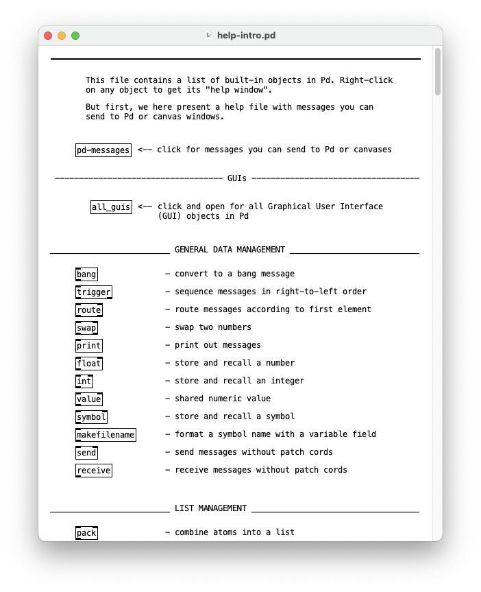
<figcaption><u>Fig. 1.2.3</u> The "help-intro' patch with a list of all internal objects</figcaption>
</figure>

The set of externals that come with Pd Vanilla is available in the ‘extra’ library and is located in a folder named “extra” inside the Pd application. These appear at the very end of the “help-intro.pd” and can also be viewed in the "Browser" menu entry in the **Help menu**. See figure below, which shows how the browser looks in a fresh install of Pd and lists the objects in the extra folder.

<figure>
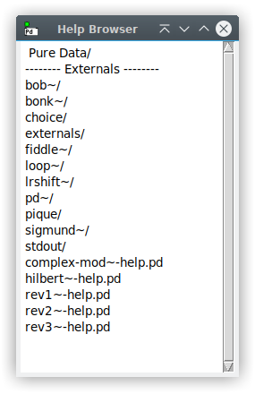
<figcaption><u>Fig. 4.1.1</u> The browser window</figcaption>
</figure>

#### <a href="#s4.1.2" id="s4.1.2">4.1.2. Types of external objects</a>

An object in Pd can be either a patch file (an abstraction) or a compiled binary. Nonetheless, a binary can contain only one or several external objects, as discussed below.

##### <a href="#s4.1.2.1" id="s4.1.2.1">4.1.2.1. Compiled objects</a>

Compiled objects are binaries compiled from code (like C or C++). They have to be compiled to match your Pd application. Pd is made available for different Operating Systems, namely Linux, macOS and Windows. Moreover, it is available for different CPU architectures and numerical precision (32-bit or 64-bit floats aka "single-precision floating point numbers" or "double-precision floating point numbers" respectively "single" or "double").

In [Chapter 3: Installing and configuring Pd](3.installing.configuring.htm) you can see how to download different Pd applications. Most commonly, you'll have Pd installed as a 64-bit application, which corresponds to most recent systems.

A Pd application compiled for 32-bit systems is mostly suited to run old externals that were not yet compiled for 64-bit systems. Most relevant and maintained externals are provided for 64-bit systems though; but of course, there can be cases where one is running Pd on an (old) system that only supports 32-bit applications.

Also, at this point, Pure Data does not officially support double-precision numbers. You can download **Pd64** beta releases or compile them yourself though (for compilation instructions, see [Chapter 6: Building Pd from source](6.building.from.source.htm)). Note that the numerical resolution of Pd and Pd64 here must not be confused with the register size of the system it's running on.

The Pd64 application requires specially compiled externals. As this is a recent development and not yet fully supported, only a few libraries are currently available.

You can have externals for different operating systems, architectures, and even for single- and double-precision numbers (i.e., for Pd and Pd64) in the same folder with different file extensions. Refer to the table below for common combinations:

<figure>
<table class="center">
<thead>
<tr>
<th>OS</th>
<th>CPU-architecture</th>
<th>Pd / Pd64</th>
<th class="left">extension</th>
</tr>
</thead>
<tbody>
<tr>
<td>Linux</td>
<td><em>unspecified</em> (any architecture)</td>
<td>Pd</td>
<td class="left"><code>.pd_linux</code></td>
</tr>
<tr>
<td>‘’</td>
<td>i386 (32-bit)</td>
<td>Pd</td>
<td class="left"><code>.l_i386</code></td>
</tr>
<tr>
<td>‘’</td>
<td>‘’</td>
<td>Pd</td>
<td class="left"><code>.linux-i386-32.so</code></td>
</tr>
<tr>
<td>‘’</td>
<td>‘’</td>
<td>Pd64</td>
<td class="left"><code>.linux-i386-64.so</code></td>
</tr>
<tr>
<td>‘’</td>
<td>amd64/x86_64 (64-bit)</td>
<td>Pd</td>
<td class="left"><code>.l_amd64</code></td>
</tr>
<tr>
<td>‘’</td>
<td>‘’</td>
<td>Pd</td>
<td class="left"><code>.linux-amd64-32.so</code></td>
</tr>
<tr>
<td>‘’</td>
<td>‘’</td>
<td>Pd64</td>
<td class="left"><code>.linux-amd64-64.so</code></td>
</tr>
<tr>
<td>‘</td>
<td>arm (32-bit)</td>
<td>Pd</td>
<td class="left"><code>.l_arm</code></td>
</tr>
<tr>
<td>‘’</td>
<td>‘’</td>
<td>Pd</td>
<td class="left"><code>.linux-arm-32.so</code></td>
</tr>
<tr>
<td>‘’</td>
<td>‘’</td>
<td>Pd64</td>
<td class="left"><code>.linux-arm-64.so</code></td>
</tr>
<tr>
<td>‘’</td>
<td>arm64/aarch64 (64-bit)</td>
<td>Pd</td>
<td class="left"><code>.l_arm64</code></td>
</tr>
<tr>
<td>‘’</td>
<td>‘’</td>
<td>Pd</td>
<td class="left"><code>.linux-arm64-32.so</code></td>
</tr>
<tr>
<td>‘’</td>
<td>‘’</td>
<td>Pd64</td>
<td class="left"><code>.linux-arm64-64.so</code></td>
</tr>
</tbody>
<tbody>
<tr>
<td>macOS</td>
<td><em>unspecified</em> (any architecture)</td>
<td>Pd</td>
<td class="left"><code>.pd_darwin</code></td>
</tr>
<tr>
<td>‘’</td>
<td>fat (multiple archs)</td>
<td>Pd</td>
<td class="left"><code>.d_fat</code></td>
</tr>
<tr>
<td>‘’</td>
<td>‘’</td>
<td>Pd</td>
<td class="left"><code>.darwin-fat-32.so</code></td>
</tr>
<tr>
<td>‘’</td>
<td>‘’</td>
<td>Pd64</td>
<td class="left"><code>.darwin-fat-64.so</code></td>
</tr>
<tr>
<td>‘’</td>
<td>i386 (32-bit)</td>
<td>Pd</td>
<td class="left"><code>.d_i386</code></td>
</tr>
<tr>
<td>‘’</td>
<td>‘’</td>
<td>Pd</td>
<td class="left"><code>.darwin-i386-32.so</code></td>
</tr>
<tr>
<td>‘’</td>
<td>‘’</td>
<td>Pd64</td>
<td class="left"><code>.darwin-i386-64.so</code></td>
</tr>
<tr>
<td>‘’</td>
<td>amd64/x86_64 (64-bit)</td>
<td>Pd</td>
<td class="left"><code>.d_amd64</code></td>
</tr>
<tr>
<td>‘’</td>
<td>‘’</td>
<td>Pd</td>
<td class="left"><code>.darwin-amd64-32.so</code></td>
</tr>
<tr>
<td>‘’</td>
<td>‘’</td>
<td>Pd64</td>
<td class="left"><code>.darwin-amd64-64.so</code></td>
</tr>
<tr>
<td>‘’</td>
<td>arm64/aarch64 (<em>Apple Silicon</em>; 64-bit)</td>
<td>Pd</td>
<td class="left"><code>.d_arm64</code></td>
</tr>
<tr>
<td>‘’</td>
<td>‘’</td>
<td>Pd</td>
<td class="left"><code>.darwin-arm64-32.so</code></td>
</tr>
<tr>
<td>‘’</td>
<td>‘’</td>
<td>Pd64</td>
<td class="left"><code>.darwin-arm64-64.so</code></td>
</tr>
</tbody>
<tbody>
<tr>
<td>Windows</td>
<td><em>unspecified</em> (any architecture)</td>
<td>Pd</td>
<td class="left"><code>.dll</code></td>
</tr>
<tr>
<td>‘’</td>
<td>i386 (32-bit)</td>
<td>Pd</td>
<td class="left"><code>.m_i386</code></td>
</tr>
<tr>
<td>‘’</td>
<td>‘’</td>
<td>Pd</td>
<td class="left"><code>.windows-i386-32.dll</code></td>
</tr>
<tr>
<td>‘’</td>
<td>‘’</td>
<td>Pd64</td>
<td class="left"><code>.windows-i386-64.dll</code></td>
</tr>
<tr>
<td>‘’</td>
<td>amd64/x86_64 (64-bit)</td>
<td>Pd</td>
<td class="left"><code>.m_amd64</code></td>
</tr>
<tr>
<td>‘’</td>
<td>‘’</td>
<td>Pd</td>
<td class="left"><code>.windows-amd64-32.dll</code></td>
</tr>
<tr>
<td>‘’</td>
<td>‘’</td>
<td>Pd64</td>
<td class="left"><code>.windows-amd64-64.dll</code></td>
</tr>
</tbody>
</table>
<figcaption><u>Table 4.1</u>File extensions for different operating systems, architectures and numerical precision</figcaption>
</figure>

##### <a href="#s4.1.2.2" id="s4.1.2.2">4.1.2.2. Abstractions</a>

You can have a Pd patch behave like an object by loading it into other patches - these are usually called “abstractions” (see [2.8.1. Abstractions](2.theory.of.operation.htm#s2.8.1)). Note that some of the externals in “extra” are abstractions (for instance, **\[rev1~\]** or **\[hilbert~\]**). Like any other Pd patch, an abstraction may contain any kind of objects (internals, compiled externals and even other abstractions).

#### <a href="#s4.1.3" id="s4.1.3">4.1.3. External libraries</a>

In practical terms, an external library is a collection of external objects of any kind (abstractions or compiled objects). But when it comes to compiled objects, a library can provide several objects as a **single binary pack** or as a **set of separate binaries** (where each object has its own binary).

The “classic” library format is a single binary pack (with two or more externals), but splitting into separate binaries became a very common practice. A single external binary (not part of any set of objects) is still, technically, a library with just one object. But again, the prevailing idea is that a library is just a set of objects.

It’s important to note that there are differences on how externals are loaded depending if they’re a single binary pack or a set of separate binaries (as explained in the next subsections).

#### <a href="#s4.1.4" id="s4.1.4">4.1.4. Types of external libraries</a>

Libraries can come in all sorts of ways; as only a collection of abstractions (like "list-abs"), only compiled objects, or both. It can even mix compiled externals both as a **set of separate binaries** and a **single binary pack**. Basically, any combination is possible for a set of externals.

One example that combines all external options is *Cyclone* (since version 0.3), which provides most of its objects as a **set of separate binaries**, but also includes a small collection of 12 objects as a **single binary pack** plus a couple of abstractions.

#### <a href="#s4.1.5" id="s4.1.5">4.1.5. Wrapping up section 4.1</a>

In short, we have:

- **Internal objects:** Objects that are part of Pd Vanilla's binary.
- **External objects:** Objects that are <u>NOT</u> part of Pd Vanilla's binary.
- **Vanilla objects:** Built-in objects in the Pd Vanilla distribution (including internals and a small collection of externals - the "extra" objects).
- **Types of external objects:** Compiled binaries or abstractions.
- **External library:** Collection of external objects in any form, be it a <u>single binary pack</u> containing several objects, a <u>set of separate binaries</u> / abstractions or any combination of these.

\
\

### <a href="#s4.2" id="s4.2">4.2. GUI (.tcl) plugins</a>

There's also a catefgory of GUI externals, mostly known as "GUI plugins". These are .tcl file extensions that offer extra GUI features for the Pd application.

These plugins are normally offered with the plugin name appended by "-plugin". For example: "completion-plugin", a plugin for autocompleting objcet names. Another interesting plugin is the "patcherize-plugin", which turns bits of patches into subpatches or abstractions. These need to be placed in a search path that Pd knows about (see details in next section). These plugins are then automatically loaded when Pd starts up.

The actual filename is then something like "completion-plugin.tcl" and it comes inside a folder with the same name (completion-plugin). In this situation, Pd knows to search inside that folder for the plugin!

### <a href="#s4.3" id="s4.3">4.3. Installing externals and GUI plugins</a>

Installing externals and GUI plugins in Pd is quite simple, all you need to do is download them from somewhere (such as from Pd directly as explained later) and include them in a proper folder.

#### <a href="#s4.3.1" id="s4.3.1">4.3.1. Where to include externals and GUI plugins</a>

Currently, when launching for the first time with a fresh install, Pd asks if you want to create a documents directory for patches that includes an “externals” subdirectory. This externals folder is where it’s advised to include externals and GUI plugins. This path is automatically included in the user added search paths (under the 'Path' tab in Preferences), see figure below.

<figure>
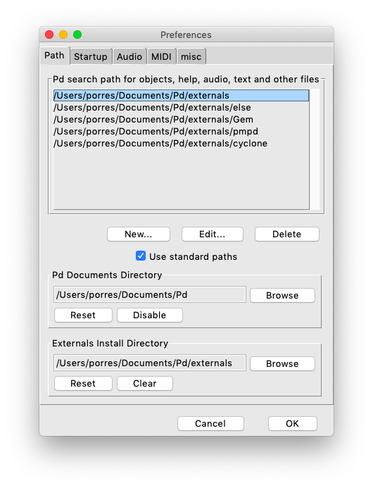
<figcaption><u>Fig. 4.3.1</u> The Path preferences with a few user added paths</figcaption>
</figure>

We see in the screenshot above that the “Pd” folder is created under ~/Documents, and inside it we have the "externals" subfolder. Even if you did not create this folder, here is where you can create it by clicking the “Reset” button under “Pd Documents Directory”. The picture also shows other paths for external libraries, all inside the ~/Documents/Pd/externals.

Externals can actually be anywhere in your computer, but Pd must know where to look for them. Pd looks for files (including externals) in the user added search paths, but it also searches in other folders not listed there such as: the same folder that your patch is saved on (the <u>Relative Path</u>) and the <u>Standard Paths</u>. Note the "Use standard paths" toggle in the picture above, which is on by default. This tells Pd to use these paths, which are:

- A\) <u>Application-specific</u>: The "extra" folder inside a particular Pure Data application.
- B\) <u>User-specific</u>: A system folder for a specific user in the machine.
- C\) <u>Global</u>: A system folder for all users on the machine.

Officially, there’s only one ‘Standard Path’ which is the ‘extra’ folder. The others are not automatically created by Pd and are part of an old structure. Currently, the best practice is to use the default external folders or user added paths, but these other options are documented here anyway and may be useful in some edge cases.

The <u>Global</u> folder affects all Pure Data Applications for all users. The <u>User-specific</u> folder affects all Pure Data Applications for that user. And since you can have different versions of Pd installed in your system, the <u>Application-specific</u> folder affects only that particular Pd Application - multiple Pd applications can be of different versions (an older and a newer one or both single and double precision variants). For reference, here’s the list of the Standard Paths for all operating systems:

A\) macOS:

- <u>Application-specific</u>: **/\$PdPath/Contents/Resources/extra** - this is inside the Pd Application (like Pd-0.49-1 in ~/Applications); right click it and choose "Show Package Contents", then navigate to "extra".
- <u>User-specific</u>: **~/Library/Pd** (/Users/user_name/Library/Pd)
- <u>Global</u>: **/Library/Pd**

B\) Windows:

- <u>Application-specific</u>:  **%ProgramFiles(x86)%\Pd\extra** (for 64-bit OS and 32-bit Pd) or %ProgramFiles%\Pd\extra; this is inside the Pd Application (usually in C:\Program Files). This folder needs to be set to writeable.
- <u>User-specific</u>:  **%AppData%\Pd** (usually in C:\Users\user_name\AppData\Roaming\Pd).
- <u>Global</u>:  **%CommonProgramFiles%\Pd** (usually in C:\Program Files\Common Files\Pd).

C\) GNU/Linux:

- <u>Application-specific</u>:  **/usr/lib/pd/extra** if installed via a package manager (apt-get) or /usr/local/lib/pd/extra if compiled by yourself.
- <u>User-specific</u>:  **~/.local/lib/pd/extra** (preferred since version Pd-0.47-1) or ~/pd-externals (deprecated but still usable).
- <u>Global</u>:  **/usr/local/lib/pd-externals**.

#### <a href="#s4.3.2" id="s4.3.2">4.3.2. How to download externals and GUI plugins from Pd</a>

Since version 0.47-0, Pd Vanilla has its own external manager! This is a built in .tcl plug-in named "deken" (check <https://github.com/pure-data/deken> for reference). Open it by selecting the "Find externals" entry from the **Tools menu**. Then you can type and search for an object name, a library name or both. The wildcard '\*' can be used to broaden the search, or an exact name can be used instead. All available versions of the library/external specific for your operating system will be shown to you. See figure below. Note that you can also download GUI plugins from deken. Search for '\*-plugin' to get a list of all options.

<figure>
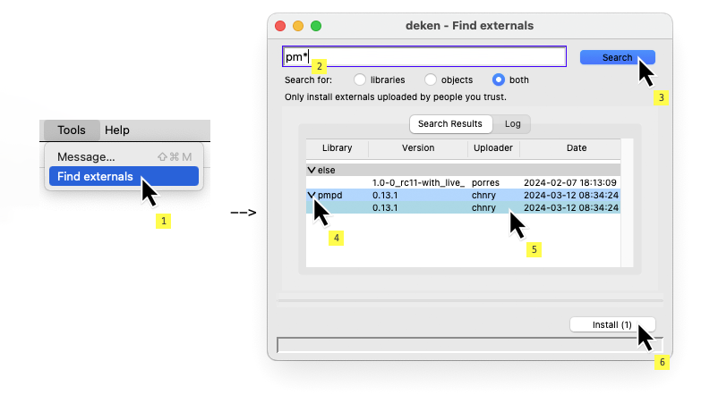
<figcaption><u>Fig. 4.3.2</u> Installing external libraries from 'deken'</figcaption>
</figure>

When you double-click on library and version you want, by default Pd downloads it to "~/Documents/Pd/externals". Note you can click on multiple libraries and download them at the same time. Note also you can search for multiple objects and libraries by separating the search entries with commas.

<figure>
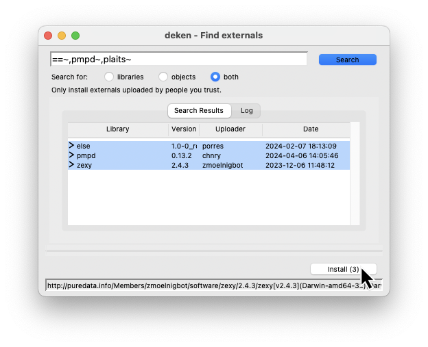
<figcaption><u>Fig. 4.3.3</u> Installing multiple libraries at once</figcaption>
</figure>

Moreover, if you have a an object creation error in the console, you can right click on the error to open a context menu with a "Find externals" entry. This will open the plugin manager with a prompt search for the missing object ready to go.

<figure>
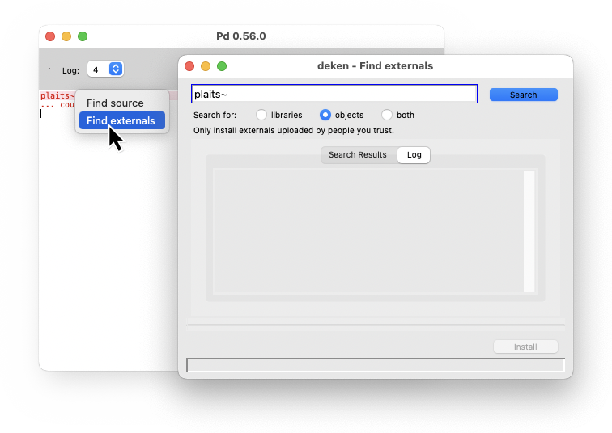
<figcaption><u>Fig. 4.3.4</u> Searching object in the plugin manager via the console window error</figcaption>
</figure>

Note that when the external manager window is focused, there are dedicated menus: **File** and **Edit**. You can use **File** to open and install a ".dek" file, and **Edit** to open "Preferences" for the plugin manager. For macOS these menus are on the top bar.

<figure>
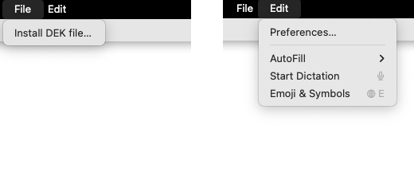
<figcaption><u>Fig. 4.3.5</u> The plugin manager's menus</figcaption>
</figure>

And the plugin manager's preferences are as follows:

<figure>
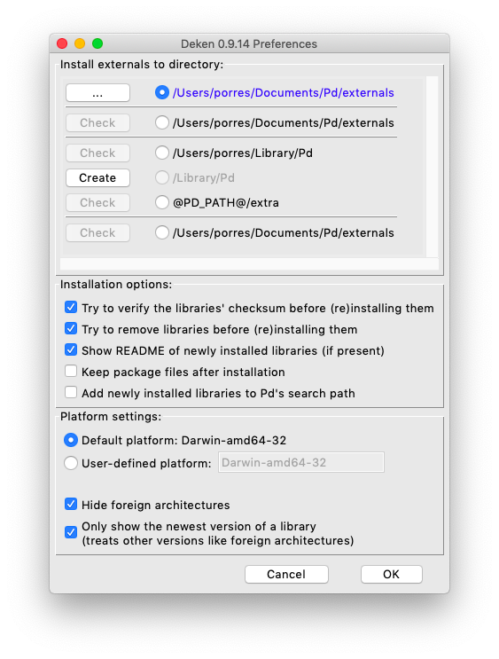
<figcaption><u>Fig. 4.3.6</u> The plugin manager's preferences</figcaption>
</figure>

The above are the default settings. If you want to see results that are not suited for your system, uncheck "Hide foreign architectures". If you want to find older versions of the library, uncheck "Only show the newest version of a library".

### <a href="#s4.4" id="s4.4">4.4. Loading externals</a>

The current best practice is to use the **\[declare\]** object to search for, load and manage externals, but there are alternatives.

If the object is from a library that is distributed as a single binary pack, this binary needs to be pre loaded at start time by Pd, so it can create its externals. This is done either with **\[declare\]** or manually via the 'Startup' tab in Preferences.

If the external library only contains abstractions or objects compiled as a set of separate binaries, Pd just needs to know its path. Again, this can be done via **\[declare\]** or manually via the 'Path' tab in Preferences, but yet another option here is to use slash declarations as we'll see later.

#### <a href="#s4.4.1" id="s4.4.1">4.4.1. Using the <strong>[declare]</strong> object</a>

The **\[declare\]** object can be used to add search paths or load libraries. When adding a path, it behaves quite similarly to adding search paths to the user added paths via the 'Path' tab in Preferences. The difference is that this will only work for the patch that contains this **\[declare\]** object - unlike using Path preferences, which loads the path(s) permanently for any patch.

As for loading a library, once Pd loads it (via **\[declare\]** or startup) it sticks with it. This means that if you use **\[declare\]** to load a library, it will also be loaded if you create a new patch without any **\[declare\]** object.

##### <a href="#s4.4.1.1" id="s4.4.1.1">4.4.1.1. [declare -path]</a>

Let's take for an example the [ELSE](http://github.com/porres/pd-else) library. This library mostly contains separate binaries and abstractions, so Pd only needs to know its location path to load them. We then use the '-path' flag as in \[declare -path else\]. This makes Pd look for a folder named 'else' to add it to the search path for that patch only.If it succeeds, this is where Pd will prioritize the search of objects and other files, moving on to other possible search places if nothing is found.

But where does Pd look for the 'else' folder? Well, the -path flag is first meant to search in the Relative Path, but if it doesn't find it, it falls back to the User Added Paths and Standard Paths. So let’s say you put the ELSE library folder in “~/Documents/Pd/externals”, which is the current best practice, Pd will know to look for it there and will find it!

Now, in the case of a single external, the best practice is to include it in a folder with the same name in “~/Documents/Pd/externals”. An example, the **\[freeverb~\]** external should be in “~/Documents/Pd/externals/freeverb~”. In this situation, you don’t need to add the external folder to the path, manually or use **\[declare\]**. This is because when you tell Pd to look for an external, if it finds a folder with the same name as the external, it'll know to search inside that folder for the external!

##### <a href="#s4.4.1.2" id="s4.4.1.2">4.4.1.2. [declare -lib]</a>

The '-lib' flag is needed for the classic Pd library format, which is a single binary pack with many externals. One such example is the [Zexy](https://git.iem.at/pd/zexy/) library. So you should download and have the 'zexy' folder in “~/Documents/Pd/externals/zexy”. Now you can use **\[declare -lib zexy\]** to load the external binary. In the same way as explained with the **\[freeverb~\]** example, the binary is inside a folder with the same name. So Pd will search for the external in “~/Documents/Pd/externals", will find the 'zexy' folder and know to search for the zexy binary in it. This means you don't need to bother in using **\[declare\]** to define the search path.

Note that it may be possible for you to load a library binary as an object if the developer wished to. But it's still advisable to use either "Startup" or **\[declare -lib\]**, because this way you are sure the library is preloaded before Pd tries to create other objects in your patch.

The ELSE library also offers a binary for you to load as a library. This is a very special case as this binary does not actually load any external. What it actually loads are some .tcl plugins that add an object browser at right clicking on a patch canvas. It also prints information about the release on the Console window. Moreover, you can also load **\[else\]** as an object in a patch and it offers the functionality of outputting its version for you to check in the patch if it is the correct one.

The Cyclone library also allows you to load **\[cyclone\]** as an object and offers the same version output functionality as in ELSE.

For more details on how **\[declare\]** works, please check its help file!

#### <a href="#s4.4.2" id="s4.4.2">4.4.2. Load via path and startup</a>

We'll now see the differences between using **\[declare\]** or using "Path" and "Startup" tabs in Preferences.

##### <a href="#s4.4.2.1" id="s4.4.2.1">4.4.2.1. User added path</a>

One big difference in adding a search path in 'Preferences' is that this permanently adds the path and works every time Pd starts and for any patch you open. When you use **\[declare\]**, the path is loaded only for its owning patch and loaded abstractions. Moreover, if you have an abstraction with \[declare -path\], it'll only work for that abstraction and not the parent patch! Hence, **\[declare\]** allows a much better control and management of paths. But you may want to permanently add a path in your own system if you know exactly what you have and what you need.

We’ve seen that even if you have a folder in “~/Documents/Pd/externals” you still need to tell Pd to look for it. You can manually add a User Added Paths in Preferences =\> Path by clicking “New”.

Another possibility is that under deken’s preferences tabs you can click on “Add newly installed libraries to Pd’s search Path”, which adds downloaded libraries to the user added search paths (see picture above).

Note also that having a user added search path will not make it have search priority like it happens when you use **\[declare\]**. In this case, the path relative to the patch will have top priority!

##### <a href="#s4.4.2.2" id="s4.4.2.2">4.4.2.2. Startup</a>

"Preferences =\> Startup" loads a window that says *"Pd libraries to load on startup"*. This is where you can manually and permanently load single binary pack libraries. But since they're only needed during startup, you need to restart Pd so this takes effect. The startup is also used for configuring Pd in many ways, see [3.4.1 Startup flags](3.installing.configuring.htm#s3.4.1) for details.

<figure>
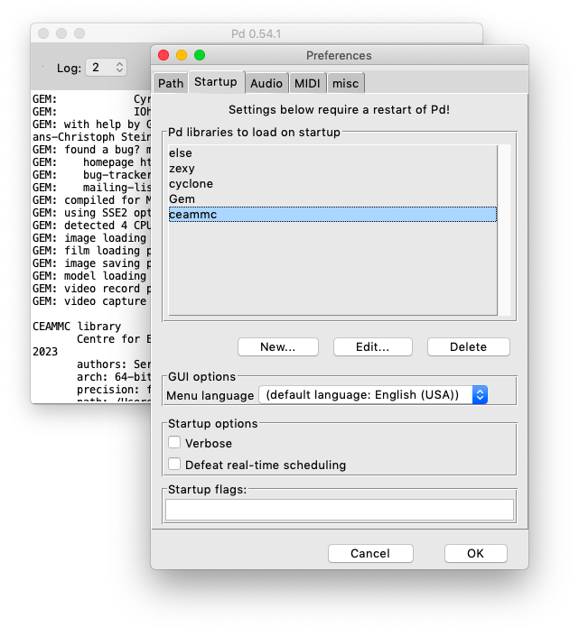
<figcaption><u>Fig. 4.4.1</u> The Startup preferences with library binaries to load</figcaption>
</figure>

As we’ve seen with ‘zexy’, it’s common that the name of the binary is the same as the library’s, so you don’t need to worry about adding it to the path. There are many other examples in the picture above. One particularity [Gem](https://github.com/umlaeute/Gem) is that it also forces Pd to add its path to the search paths, which is needed for some abstractions and then you don’t need to bother adding it to the path. Note, however, that unlike using **\[declare\]**, this does not enforce a top search priority! Hence, for example, you may prefer to use **\[declare -path Gem -lib Gem\]** instead.

It all depends on the developer, but it is a common and good practice that when you load a library, Pd’s terminal window will print something to tell us that the libraries were loaded successfully. Here’s a screenshot of the result of loading cyclone.

<figure>
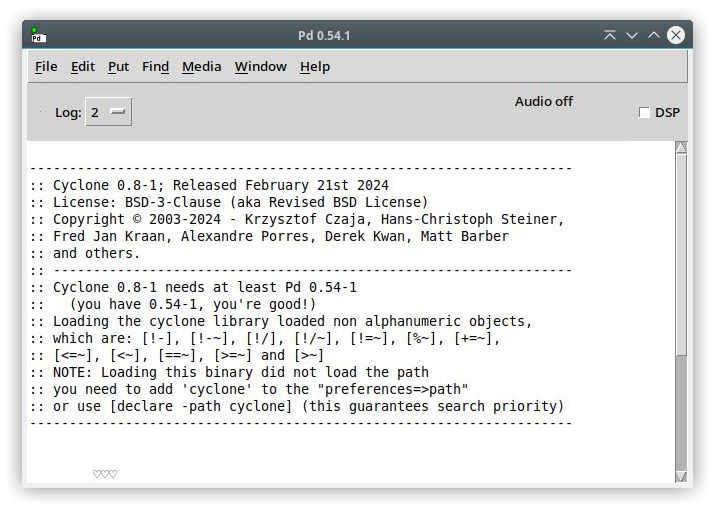
<figcaption><u>Fig. 4.4.2</u> Library loading printout</figcaption>
</figure>

Note that when you load a library via Startup or **\[declare -lib\]**, all of its external objects are loaded in Pd and they have search priority over other externals that are loaded via paths. This may cause issues discussed on the next section.

#### <a href="#s4.4.3" id="s4.4.3">4.4.3. Load using slash declarations</a>

Let’s say you’ve downloaded the ELSE library into ~/Documents/Pd/externals. Instead of using **\[declare -path else\]** or adding the ELSE folder to the user added paths manually, you can just prepend “else/“ before an object name. This will make Pd look for this object in a folder called ‘else’ in one of its search paths (which includes ~/Documents/Pd/externals) and find it! Here’s an example:

<figure>
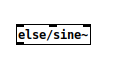
<figcaption><u>Fig. 4.4.3</u> An external object with a slash declaration</figcaption>
</figure>

This can be an option that some people may prefer for the simple fact that it's just clearer from which library folder we're loading the external. But there are some rare cases where this is the only way to guarantee you have loaded the correct external, which is a problem when you have too many libraries in your system and are using more than one that has an external with the same name. Hence, some external libraries like 'Cyclone' and 'ELSE' use this in the documentation of the help files to make sure you load the correct external.

Note, however, that this is not possible for an external that is loaded as part of a single binary pack, unless the developer uses a workaround to add this possibility as alternative.

The issue with **\[declare\]** or adding a path to the user added paths is that it'll respect a search order. Whatever path is added first in the search list order has a priority, and where ever Pd finds an external first, it'll load it and stop searching elsewhere. Again, this kind of problem is not that common, but you can solve this with slash declarations. You may also be able to sort this issue by setting the desired order. This is quite easy in **\[declare\]** as which ever -path comes first in the list has a priority, so you can try that if you want to avoid slash declarations when you run into this rare issue.

Name clash conflicts can also happen when you're loading single binary pack libraries. The problem is that once they get loaded, all of its external objects are now part of Pd and have a priority in the search. Here's an example, the 'ceammc' library is a single binary pack and it included an object called **\[xfade~\]**. The ELSE library has separate binaries for each object and also has one called **\[xfade~\]**. If you're using both libraries, ceammc's **\[xfade~\]** object will have priority and it doesn't help you to have \[declare -path else\].

It was mentioned how a library name prefix may also be possible in the context of single binary packs. The ceammc library offers this, so you can also load its **\[xfade~\]** object as **\[ceammc/xfade~\]**. But note that this still requires you to preload the binary (via startup or **\[declare\]**). The slash declaration here was only possible because the developer added the 'ceammc/xfade~' name as an alternative option in the code. So it is just a hack to improve the limitation of Pd in handling namespaces. Another library that does this is Cyclone, which carries a sublibrary with 12 objects with non alphanumeric names, such as **\[\>~\]**. By using the same trick, you can create the **\[\>~\]** object as **\[cyclone/\>~\]**. Another single binary pack library that has **\[\>~\]** is zexy, so this way you can make sure you're getting cyclone's instead.

These issues might be clear if you better understand how Pd works when loading externals. See next subsection.

### <a href="#s4.5" id="s4.5">4.5. How external binaries are loaded</a>

Once you make sure Pd can load an external binary via a path, this is what happens when you create it. Whenever you create an object that Pd doesn't yet know about, Pd looks for the object file named as, for instance, "profile.pd_linux". Pd looks first in a path defined by **\[declare\]** (if any, of course), then in the directory containing the patch, then in directories listed as user added paths in the order they are listed, then in the standard paths. As soon as Pd finds the object in this search order, it'll stop searching further more and will add the found object to its "class list", which is the set of all Pd classes you can use. Pd then tries to create the object you asked for, and if everything is fine with it, this happens successfully (creation errors are given otherwise).

In the case of a single binary pack loaded at Startup or with **\[declare\]**, all the externals it contains get preloaded in Pd's class list, even though they're only created in object boxes when you require them.

In both cases, once an external object's binary is in Pd's memory, there is no real difference between it and a native object. They're all seen equally now in Pd. Once a new separate binary or single binary pack is loaded, it's there for the duration of your Pd session. This means that if you replace the binaries, the objects won't be updated even if you recreate them. You can also even delete the binary as Pd now carries it for good in its memory. Hence, if you're working on the development of an object's binary and decide to change it, you have to exit and re-enter Pd to get the change to take effect.

Let us just make the distinction that external abstractions work quite differently! As they get updated any time they’re updated and reloaded!

#### <a href="#s4.5.1" id="s4.5.1">4.5.1. Overriding objects (externals and native)</a>

We've seen that Pd loads and sticks to an external binary, but they can get overridden. For instance, if you create **\[xfade~\]** from ELSE and then load ceammc's binary later (that also has an **\[xfade~\]** object), Pd only knows about **\[xfade~\]** from ceammc! It's been also noted how cyclone and zexy have objects with the same name. If you first load cyclone's binary and zexy's later, zexy's objects with the same name (such as **\[\>~\]**) will override and prevail.

And here's an interesting feature, you can also override internal objects with externals! Say you have an external called **\[phasor~\]**. If it's a single binary, you can force Pd to find it with slash declarations. Otherwise, if it's a binary pack, you can load as any other library and if it has objects with the same name as vanilla's internals, they get overridden! But Pd still keeps a copy of the old one and renames it by appending "\_aliased", so you can still load the old "phasor~", for instance, as **\[phasor~\_aliased\]**. You probably don't want to mess with overriding internals, but it makes sense if you provide new versions with more features that are fully backwards compatible.

### <a href="#s4.6" id="s4.6">4.6. Search order in Pd for objects and files</a>

This information has been provided in pieces throughout this section of the Manual. But now well wrap it up after all the information has been presented.

So, whenever you tell Pd to create an object in its box, this is what happens.

**First** it searches in its object list. This includes all of Pd's internals and other externals that may have been previously loaded.

**Second** it moves on to unknown objects in possible paths. And if you have \[declare -path\] in your patch, the defined path(s) has/have priority respecting the order they are listed from left to right.

**Third** is time to search the path relative to the patch.

**Fourth** it goes to the user added paths, defined at "Path" in "Preferences". An order is also respected, from top to bottom.

**Fifth** and last, it searches the "standard paths", which includes the 'extra' library provided by the Pd Vanilla distribution. Note you can use **\[declare -stdpath ./\]** to force priority to search this folder!

Regarding files, the search order is the same, only the first step is ignored.

[\< Chapter 3: Installing and configuring Pd](3.installing.configuring.htm)

[Table of contents](index.htm#s4)

[Chapter 5: Current status \>](5.current.status.htm)

